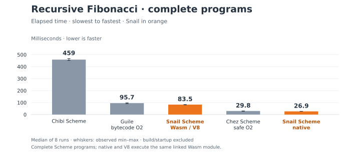
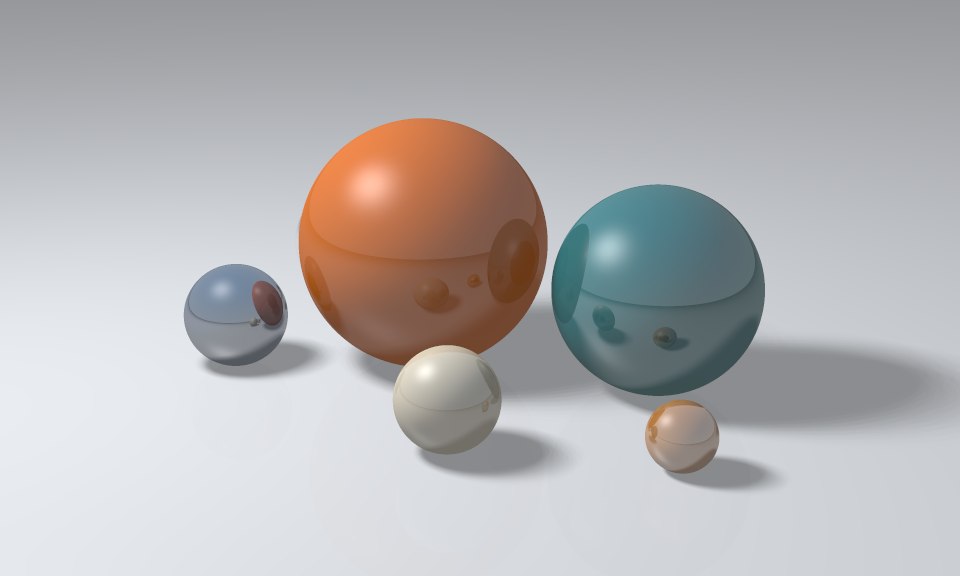
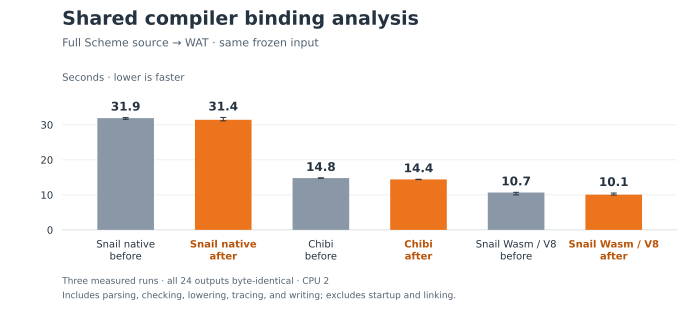
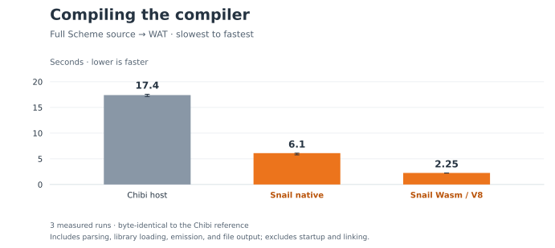

# Benchmarks

**Runtime comparisons exclude compilation and process startup.** The
[compiler benchmark](#compile-the-compiler) measures compilation itself.



Native Snail takes **9.7% less time than Chez** and runs **3.56× faster than
Guile** on this recursive Fibonacci workload. Every implementation runs the
complete [Scheme program](benchmarks/cpu.scm); at the recorded revision, native and V8 execute the same
Rust-linked Wasm module. The current native build uses shared Wasm datums and a
native Rust archive, so these historical results do not measure that pipeline. Bars show medians, ordered slowest to fastest;
whiskers show the observed minimum and maximum. Orange identifies Snail.
See the [generated table](benchmarks/results/2026-10-10-native-fibonacci/summary.md)
and [raw measurements](benchmarks/results/2026-10-10-native-fibonacci.json).

## Reproduce the comparison

Use an otherwise idle x86-64 Linux machine with Rust/Cargo and the
`wasm32-wasip1` target installed:

```sh
nix-shell benchmarks/shell.nix
BENCH_CPU=2 benchmarks/native
```

The runner builds all implementations, then measures eight rotating rounds of
64 repetitions on one CPU after a discarded run per implementation. Every run
must produce checksum `269118144`. `BENCH_CPU` selects an allowed CPU.
It saves raw samples, commands, tool versions, and source/artifact hashes in
`build/native-benchmark/results.json`, alongside a table and SVG/PNG plots.
Regenerate plots without rebuilding or running workloads:

```sh
benchmarks/native --plot build/native-benchmark/results.json
```

This measures one call/arithmetic workload. Compare implementations within the
same run; absolute times vary with hardware, tools, and load. These observations
are not CI performance thresholds. The [native benchmark notes](doc/native-benchmarks.md)
retain the complete methodology, code-generation ablation, translation latency,
and historical measurements. [`reproduce.py`](benchmarks/reproduce.py) rebuilds
the earlier extracted-function comparison at its pinned historical revision.

## Run the R7RS suite

The broader runner uses all 57 workloads from
[ecraven's R7RS benchmarks](https://github.com/ecraven/r7rs-benchmarks), derived
from the Larceny, Gabriel, and Gambit suites. A pinned
[submodule](benchmarks/r7rs-benchmarks) supplies the unchanged benchmark bodies
and correctness predicates. The suite covers allocation, lists, arrays,
strings, IO, numeric computation, and control
flow. Initialize the submodule once:

```sh
git submodule update --init benchmarks/r7rs-benchmarks
```

With Rust/Cargo and the `wasm32-wasip1` target installed, use the same Nix shell:

```sh
python3 benchmarks/r7rs.py --cpu 2
```

The runner compiles each complete program through `(snail-scheme native)`: the
Wasm datum is resolved into LLVM and linked with the native Rust archive.
Default participants are Snail native, Chez, Guile, and Chibi. Missing tools and
failed builds remain visible in the report; requested native cases execute
native code. The retired binary-reader override is no longer accepted.

For a quick harness check on the reference implementations:

```sh
python3 benchmarks/r7rs.py --systems chez guile chibi \
  --benchmarks fib array1 quicksort --count 1 --rounds 1 --timeout 30
```

`--count` replaces only the upstream iteration count and labels the result as a
**smoke run**. Normal runs keep original inputs. `--timeout` and
`--build-timeout` bound each process, including its descendants. All builds
finish before measurement; successful programs get one discarded preliminary
run followed by rotating measured rounds.

The runner writes JSON, CSV, and a Markdown index under `build/r7rs-report/`,
with a separate SVG/PNG bar chart for each benchmark in `plots/`. Each chart
uses its own zero-based time axis; compare heights within a chart. The index
links every benchmark to its plot.
Every requested cell remains visible, including build errors, incorrect answers,
timeouts, and unavailable implementations. It exits nonzero for failures;
`--allow-failures` permits exploratory runs without changing their recorded
status. Interrupted runs retain incomplete JSON and cannot produce a final plot.
Use `--plot PATH` to regenerate reports from saved data. There is no aggregate
score that silently drops failed benchmarks.

Suite reports stay under `build/`; published Fibonacci and compiler comparisons
are checked in. Unsupported Scheme libraries or features remain explicit build
failures; integration does not imply that Snail passes the full suite.

### Next showcase: ray tracing

The upstream [`ray` workload](benchmarks/r7rs-benchmarks/src/ray.scm) renders
33 spheres into a 100 × 100 grayscale image. It exercises floating-point math,
vectors, allocation, scene traversal, and image-file output. Original inputs
render the scene 50 times per sample; image writing is part of the timed work.

```sh
python3 benchmarks/r7rs.py --benchmarks ray --cpu 2
```

The runner checks every rendered pixel against the identical output produced
by Chez, Guile, and Chibi; upstream's return-value check alone only verifies
the symbol `ok`. Results include a pixel checksum, the timing chart appears at
`build/r7rs-report/plots/ray.svg`, and each implementation's PGM image is under
`build/r7rs-report/cases/ray/<system>/outputs/ray.output`.

This is the next proposed README comparison, pending Snail execution. The
`(scheme inexact)` library now passes linked-Wasm execution checks. The ray
program next fails on the missing `(scheme read)` library before native
translation; no Snail ray-tracing timing is published. To exercise the
reference engines and image checks now:

```sh
python3 benchmarks/r7rs.py --systems chez guile chibi --benchmarks ray \
  --count 1 --rounds 1
```

### Studio scene



[`studio.scm`](benchmarks/studio.scm) renders colored materials, soft shadows,
and two reflection bounces. The image above is a 960 × 576 Chez reference
render with nine camera rays per pixel and 64 fixed area-light samples.
The scene and sampling are deterministic. Reproduce it with:

```sh
nix-shell benchmarks/shell.nix
python3 benchmarks/render-studio.py --width 960 --samples 3
```

The wrapper writes the actual PPM pixels and a PNG preview under `build/studio/`.
It prints elapsed time including process startup and PPM output, excluding
compilation and PNG conversion. This render took 125.34 seconds on our host
with Chez; that single observation is not an implementation comparison.
Use `--system guile` or `--system chibi` to run the same Scheme program on another
reference implementation; `--width 32 --samples 1` provides a quick check.
This visual showcase is separate from the upstream `ray` timing workload and
has no published Snail timing yet.

## Compile the compiler

The compiler passes child facts through the visitor, with immutable binding
scopes and no expression caches. The latest simplification shares binding
metadata across checking, closure analysis, and constant evaluation:

| Compiler host | Before | After | Change in time |
| --- | ---: | ---: | ---: |
| Chibi | 14.789 s | 14.408 s | -2.6% |
| Snail Wasm / V8 | 10.661 s | 10.061 s | -5.6% |
| Snail native | 31.901 s | 31.429 s | -1.5% |



Three rotating measured rounds follow one discarded run per case. All 24 outputs
are byte-identical across both implementations and all three hosts. Wasm and
native sample ranges overlap; these are modest observed changes. See the
[method, runtime refresh, and frozen sources](benchmarks/results/2026-10-10-compiler-simplification/README.md)
and [raw report](benchmarks/results/2026-10-10-compiler-simplification/results.json).
Chibi remains the supported compiler host. WAT writing takes 0.12–0.26 seconds;
compiler preparation and linking are outside the timer.

The earlier [visitor comparison](benchmarks/results/2026-10-10-visitor-typing/README.md)
records the cost of removing expression caches on a different frozen input.
The [indexing experiment](benchmarks/results/2026-10-10-compiler-indexes/README.md)
remains historical evidence. Neither expression caches nor the subsequent HAMT
proposal are in the review stack.

A separate [direct-call and inlining experiment](benchmarks/calls/README.md)
finds a modest benefit from calling known primitive adapters, a larger gain on
a focused native callback workload from closure analysis, and regressions from
raising the global inlining threshold. It does not support a general 5–10× gain.

### Earlier compiler corpus

The measurements below use an earlier, smaller compiler and its original native
pipeline. Their absolute timings are not comparable with the fixed-input
optimization comparison above.



Three measured rounds on October 10 at commit `5721de9` give medians of
**2.250 seconds for Snail Wasm/V8**, **6.103 seconds for Snail native**, and
**17.400 seconds for Chibi**, on CPU 2 of an Intel Core Ultra 7 270K Plus.
All twelve preliminary and measured outputs match byte for byte.
The [raw measurements](benchmarks/results/2026-10-10-compiler-current/results.json)
retain every sample, tool version, command, and source/artifact hash.
The earlier [Wasm comparison](benchmarks/results/2026-10-10-compiler-self/results.json)
at `dcd5de7` used the previous compiler and tracing implementation.

[`compile-self.py`](benchmarks/compile-self.py) runs Snail's compiler on its own
full Scheme source and imported libraries. It first freezes the sources and
builds the compiler, then times source parsing, library loading, WAT emission,
and file output. The current compiler requires tracing: nested trace work is
included, while opening and finalizing the trace file are excluded. Process
startup, building the compiler executable, assembly, and linking are outside
the timer. Every output must match the assembled, validated Chibi-hosted
reference byte for byte.

```sh
python3 benchmarks/compile-self.py --cpu 2
```

The default comparison is Chibi-hosted versus Snail native, using the checkout's
translator. To also exercise the compiled Wasm compiler:

```sh
python3 benchmarks/compile-self.py --systems chibi snail-native snail-wasm \
  --rounds 3 --output build/compiler-all-report
```

Each case gets one discarded preliminary run and rotating fresh-process
samples on one CPU. The runner records commands, source/artifact hashes, raw
times, and failures in `results.json`, and generates `compiler-self.svg`/`.png`.
Native availability never changes a case into a Wasm run. Missing tools,
timeouts, or differing output fail the comparison and remain in the report.
Choose a fresh output directory for each run; `--plot PATH` regenerates charts
from saved JSON. Chibi bootstraps the native interpreter; see the
[build guide](doc/book/builds.md) for rebuilding it with Snail.

## Language scope

Snail is not fully R7RS compliant. Reusable, multi-shot continuations are outside
the intended language; the current backend rejects `call/cc` entirely. Single-shot
delimited continuations and coroutines are planned, and other conformance gaps
remain. The Fibonacci comparison does not isolate the cost of continuations.
See [the roadmap](TODO.md) and [backend guide](doc/backend.md).

[The benchmark guide](benchmarks/README.md) retains historical measurements,
other workloads, and compiler-latency results.
