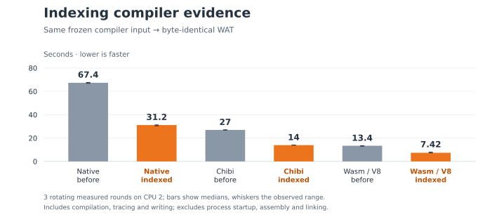

# Historical indexing experiment

This experiment measured an earlier expression-cache design. The current
compiler instead passes transient child facts directly through its visitor and
uses immutable binding scopes. Neither mutable indexes nor the later HAMT
proposal is part of the landing stack. See the [visitor comparison](../2026-10-10-visitor-typing/README.md)
for the current design.

The compiler repeatedly looked up each expression's type fact and constant fold
in association lists. Indexing those results by IR identity removes the repeated
linear scans. Source traversal still determines output order, and all preliminary
and measured compilations must produce exactly the same WAT bytes.

| Compiler host | Before | Indexed facts | Speedup |
| --- | ---: | ---: | ---: |
| Chibi host | 26.999 s | 13.985 s | 1.93× |
| Snail Wasm / V8 | 13.431 s | 7.424 s | 1.81× |
| Snail native | 67.360 s | 31.168 s | 2.16× |



One discarded preliminary run and three rotating measured rounds compare Chibi,
Snail Wasm/V8, and Snail native before and after indexing on one frozen compiler
input. Every process runs on logical CPU 2 of the recorded host. Other task builds
and benchmark runs were paused during measurement; unrelated system activity
remains possible. Internal timers include parsing, library loading, type analysis,
partial evaluation, emission, tracing, and WAT writing. They exclude process
startup and compiler executable preparation, assembly, and linking.

The input and before compiler are from integration revision `803d169`. The after
compiler is from `a72f5b2`; the active compiler dependency graph changes only in
type-fact and fold lookup (`49353a6`). The remaining changes in that revision are
documentation and an unused generator helper outside this benchmark's imports.
The corresponding review change was PR #34, now superseded. The call-optimization prototype is a
separate experiment and is absent from both measured compilers.

`results.json` retains every sample, execution order, stage times, source hashes,
compiler artifact hashes, commands, tool versions, and preparation logs.
`before-source.tar.gz` and `after-source.tar.gz` preserve the frozen compiler
sources, excluding their generated build directories. `archives.json` records
archive hashes. The version of `compare-compilers.py` used for the run is preserved
here as `measure.py.txt` for provenance; use the maintained runner under `benchmarks/`.

## Reproduce

Use two isolated worktrees of this stack. Overlay the source archives in those
worktrees to recreate each measured compiler, while retaining the benchmark
harness and Nix shell from the review stack. From each worktree, prepare its
compiler implementations with a fresh output directory:

```sh
# In the first worktree:
tar -xzf /path/to/before-source.tar.gz
nix-shell benchmarks/shell.nix --run 'python3 benchmarks/compile-self.py \
  --systems chibi snail-wasm snail-native --rounds 1 --cpu 2 \
  --timeout 600 --build-timeout 1500 --output build/prepared-before'

# In the second worktree:
tar -xzf /path/to/after-source.tar.gz
nix-shell benchmarks/shell.nix --run 'python3 benchmarks/compile-self.py \
  --systems chibi snail-wasm snail-native --rounds 1 --cpu 2 \
  --timeout 600 --build-timeout 1500 --output build/prepared-after'
```

After all preparation finishes, run the comparison from the review checkout on
an otherwise idle host. Select an allowed CPU and a fresh output directory:

```sh
nix-shell benchmarks/shell.nix --run 'python3 benchmarks/compare-compilers.py \
  --before /path/to/first/worktree/build/prepared-before \
  --after /path/to/second/worktree/build/prepared-after \
  --output /tmp/snail-compiler-comparison --cpu 2 --rounds 3'
```

Both implementations compile the first prepared report's frozen source corpus.
The runner verifies each result against that corpus's Chibi reference and checks
that neither frozen source tree changed. Its common working directory exposes
the inputs and output through the WASI launcher's existing preopen. Failed cases
remain in the report and make the command fail. An interrupted report stays
incomplete. Absolute timings depend on the recorded machine and toolchain; these
measurements do not define CI performance thresholds.
