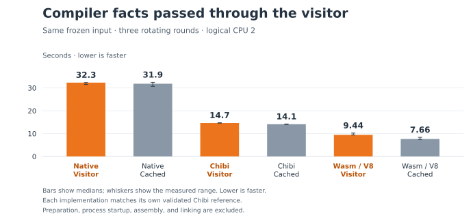

# Type facts passed through the compiler visitor

The visitor passes child facts into pure inference rules and immediately uses
their results for checking and lowering. It retains immutable binding scopes;
there is no expression-to-type cache, fold index, or typed shadow tree. This
comparison measures the architectural change against the previous indexed
compiler on the same frozen source input.

| Compiler host | Cached facts | Visitor | Change in time |
| --- | ---: | ---: | ---: |
| Chibi | 14.100 s | 14.650 s | +3.9% |
| Snail Wasm / V8 | 7.658 s | 9.435 s | +23.2% |
| Snail native | 31.859 s | 32.319 s | +1.4% |



The simplification is not a throughput improvement over the indexed compiler.
The Wasm regression remains a follow-up; three samples do not establish a
reliable difference for native. Chibi remains the supported compiler host.
Median WAT writing times after the change are 0.109 s, 0.179 s, and 0.233 s
respectively. Most of the Wasm increase is in the combined checking/lowering
visitor, rather than serialization. The trace spans changed with the pass
structure, so individual old and new pass times are not interchangeable.

## Method and limits

One discarded preliminary run and three rotating measured rounds cover all six
host/implementation combinations on logical CPU 2 of the recorded machine.
Task-owned compiler builds and other benchmarks were paused during measurement;
unrelated system activity remains possible. Timers include parsing, library
loading, analysis, folding, lowering, trace events, and WAT writing. They exclude
process startup, compiler preparation, assembly, and linking.

The input and cached compiler are frozen at `3505428`; the visitor compiler is
frozen at `40e0297`. Both include the small direct primitive-adapter optimization.
The later cleanup making rank-one inference bounds immutable is not included in
these measured artifacts. This unannotated compiler workload does not exercise
polymorphic constraint solving; use the focused typing tests for that change.

The visitor changes function emission order, so its WAT is not byte-identical
to the cached compiler's WAT. The harness assembles and validates a Chibi
reference for each implementation. All 24 preliminary and measured outputs
match their corresponding reference byte for byte, and both frozen source
manifests remain unchanged. This establishes reproducibility across the three
hosts for each implementation, not semantic equivalence between implementations.
Linked Wasm/native integration tests and guarded/optimized/folded typing
counterexamples supply the behavioral checks.

`results.json` retains every sample, execution order, stage time, tool version,
command, preparation log, and source/artifact hash. The two source archives
contain exactly the files in the corresponding source manifests, without build
products. `archives.json` records archive hashes. `measure.py` is the exact
harness used for this experiment; its hash is recorded in the report.

The earlier [indexing experiment](../2026-10-10-compiler-indexes/README.md)
remains historical evidence. Its expression caches and the subsequent HAMT
proposal are absent from the landing stack.

## Reproduce

Create two isolated worktrees of the review stack and overlay one source archive
in each. Keep the review stack's benchmark runner and Nix shell. Prepare the
three compiler hosts separately in fresh directories:

```sh
# First worktree:
tar -xzf /path/to/before-source.tar.gz
nix-shell benchmarks/shell.nix --run 'BINARYEN_CORES=1 python3 benchmarks/compile-self.py \
  --systems chibi snail-wasm snail-native --rounds 1 --cpu 2 \
  --timeout 600 --build-timeout 1500 --output build/prepared-before'

# Second worktree:
tar -xzf /path/to/after-source.tar.gz
nix-shell benchmarks/shell.nix --run 'BINARYEN_CORES=1 python3 benchmarks/compile-self.py \
  --systems chibi snail-wasm snail-native --rounds 1 --cpu 2 \
  --timeout 600 --build-timeout 1500 --output build/prepared-after'
```

After preparation finishes, run this experiment's harness from the review
checkout on an otherwise idle host, choosing an allowed CPU:

```sh
nix-shell benchmarks/shell.nix --run 'BINARYEN_CORES=1 \
  python3 benchmarks/results/2026-10-10-visitor-typing/measure.py \
  --before /path/to/first/worktree/build/prepared-before \
  --after /path/to/second/worktree/build/prepared-after \
  --output /tmp/snail-visitor-comparison --cpu 2 --rounds 3'
```

Both implementations compile the first prepared report's frozen source corpus.
The common working directory makes inputs and outputs visible through the WASI
launcher's existing preopen. Failed cases remain in the report and fail the
command; interruption leaves an incomplete report. These machine-specific
measurements do not define CI performance thresholds.
