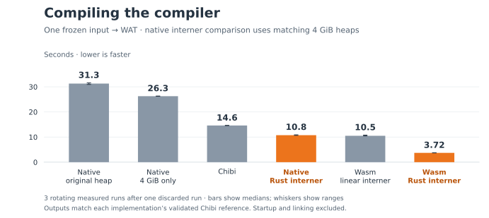
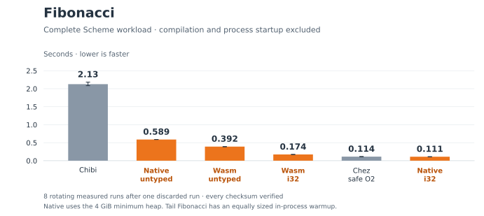
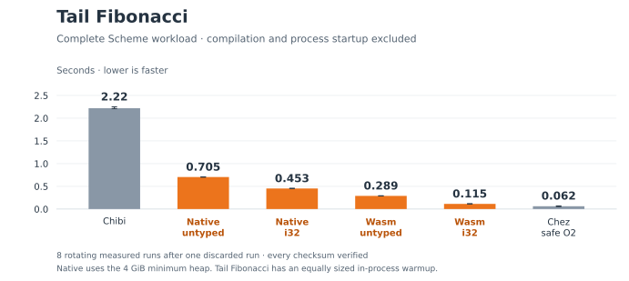

# Global Rust symbol interning

Replace the linear Scheme symbol list with one runtime-global Rust `HashMap`
and reverse name vector. Exact names determine identity; the standard map handles
hash collisions. Symbols carry 31-bit IDs in tagged atoms. Literal IDs form a
complete prefix installed before dynamic names receive IDs, and IDs are never
reset or reused. The registry owns Rust data and holds no Scheme roots.

The 4 GiB startup minimum used in these measurements was subsequently removed
from the review stack. Native startup now leaves heap sizing and automatic growth
to BDWGC; `GC_INITIAL_HEAP_SIZE` remains available for explicit experiments.
The recorded samples and source archives below retain their original heap policy.
They do not measure the new interner with the restored default heap policy.

## Compiler workload

These timings run an already-prepared compiler on the same frozen compiler source,
producing WAT. Chibi runs the compiler's Scheme source; the Snail Wasm and native
executables were compiled using Chibi before measurement. Parsing, library loading,
checking, lowering, trace events and WAT writing are timed. Building the compiler,
process startup, Binaryen and LLVM linking are excluded.

| Compiler host | Before | After | Speedup |
| --- | ---: | ---: | ---: |
| Chibi | 14.607 s | 14.612 s | approximately unchanged |
| Snail Wasm / V8 | 10.506 s | 3.721 s | 2.82× |
| Snail native, both with 4 GiB heaps | 26.273 s | 10.755 s | 2.44× |



The original native executable takes **31.289 s** with
its original heap behavior. Giving that same executable a 4 GiB initial heap
reduces this to **26.273 s**; the interner reduces it
further to **10.755 s**. Together the changes give a
**2.91×** improvement.
Native is now **1.36×** faster than Chibi
on this input, while Wasm is **3.93×** faster.
Chibi remains the supported compiler host.

Three rotating measured rounds follow one discarded run for each of seven
cases, pinned to logical CPU 2. All **28 outputs** match their implementation's
Chibi reference, and both references pass Binaryen validation. WAT differs
between implementations because the symbol representation changed. No other
task-owned compiler, build, test or profiler ran during these measured rounds.

Library-function emission drops from **7.024 to 1.206 s** on Wasm, and from
**16.233 to 3.071 s** on native with matching heaps. This stage creates many names
for functions, globals and labels. Native frontend time stays near 6.8 s with
matching heaps. WAT writing is only **0.223 s Wasm / 0.206 s native** after the
change; serialization is not the dominant remaining cost.

[compiler.json](compiler.json) retains samples, order, commands, versions,
source/artifact hashes, stage times and validation. The common input is the
previous simplification report's frozen `dbc63b6` tree, corresponding to compiler
sources in `f9047de`. It differs from that older report's input, so compare
absolute times within this report. The new frozen sources exactly match the
compiler/runtime files in review commit `2673c00`; the preparation report records
the uncommitted worktree from before those files were committed.
[archives.json](archives.json) identifies both source archives, reusing the
previous report's archive for the baseline.

## Remaining native costs

Separate diagnostic `perf` runs profile the original and new executables with
4 GiB heaps on the same input. The original linear intern path accounts for
**61.91%** of sampled cycles. After replacement, the Rust interner's named
lookup/insertion and boundary functions account for about **0.33%** of samples.
This is symbol attribution, not an inclusive cost for all string conversion.

The new native run spends **47.27%** of samples in BDWGC allocation and collection;
`$single`, which checks/unwraps single-value results, accounts for another
**15.73%**. The profile explains why native remains slower than Wasm after the
lookup fix. It does not establish that all remaining checks can be removed.
The collector log confirms expansion to at least 4 GiB before Scheme allocation.

[profiles.json](profiles.json) records commands and verified output hashes.
The [before profile](snail-native-before-4gib-symbols.txt) maps `f.350` to
`$primitive56`, the `string->symbol` wrapper containing the old intern loop.
The [after profile](snail-native-after-symbols.txt) maps `f.71` to `$single` and
`f.114` to `$same`, using the native module's function declaration order.
DSO totals and GC logs are retained beside those files. These profiles cover the
whole process and enable collector diagnostics; they are separate from timings
in the compiler table. The after profile has 4.15% unresolved samples.

## Running Fibonacci on Snail, Chez and Chibi

These timings measure the **program's execution**, excluding its compilation and
process startup. Recursive Fibonacci takes two uncurried arguments `(n, offset)`;
tail Fibonacci takes three `(n, a, b)`. The i32 annotations have two and three
parameter types respectively, followed by an i32 result type.

| Variant | Recursive, seconds | Tail, seconds |
| --- | ---: | ---: |
| Snail Wasm, untyped | 0.392087 | 0.289416 |
| Snail native, untyped | 0.588714 | 0.704811 |
| Snail Wasm, i32 | 0.173643 | 0.114587 |
| Snail native, i32 | 0.110948 | 0.453308 |
| Chez, safe O2 | 0.113630 | 0.061991 |
| Chibi | 2.127000 | 2.218500 |





Eight rotating measured rounds follow one discarded full run per variant on
CPU 2, with every checksum verified. Recursive runs use inputs 22–25, 256
repetitions and checksum `1076472576`. Tail runs use 1,048,576 repetitions,
4,194,304 top-level calls and checksum `4409231671296`, after an equally sized
in-process warmup. No other task-owned builds or tests ran during timing.

Snail native and Wasm consume identical emitted WAT per variant. The untyped
Snail source is also the input to Chibi and Chez, with the existing Chez
import/time adapter; Chez uses safe O2. Partial evaluation is disabled and the
runner checks that only i32 variants contain a specialized worker. Required
checks remain enabled. These are complete Scheme workloads, including the outer
driver and boxed entry; they do not isolate the Fibonacci worker.
Each sample uses a fresh process with V8's default tiering. Only the tail
workload has an in-process warmup.

[schemes.json](schemes.json) records every sample, generated source, command,
source/artifact hash and tool version. It was measured at `87a6c18`, whose tree
matches review commit `2673c00`. The reusable runner is
[compare-schemes.py](https://github.com/tsnl/snail-scheme/blob/2db2216b32254bbaf9b49ebed30e0bca495ec6c2/benchmarks/typing/compare-schemes.py).

## Heap size has a workload-dependent cost

A second controlled runtime experiment reuses the preserved pre-interner native
i32 executables. The same original binary runs with its default heap and with
`GC_INITIAL_HEAP_SIZE=4294967296`. A separately linked binary uses the new native
startup minimum. All binary hashes match their original build reports.

| Workload | Original binary, default | Same binary, 4 GiB environment | Startup minimum, 4 GiB |
| --- | ---: | ---: | ---: |
| fibonacci | 0.111270 | 0.111271 | 0.112598 |
| tail-fibonacci | 0.300561 | 0.445758 | 0.448789 |

Eight rotating measured rounds follow one discarded run per variant, with the
same checksums and warmups. The larger heap leaves recursive Fibonacci almost
unchanged but slows the complete tail workload by about **48%**. The environment
control reproduces the slowdown without changing the executable. This regression
motivated removing the startup minimum and restoring BDWGC's default heap policy.
[heap-control.json](heap-control.json) records the runner source, commands,
artifact hashes, order and samples.

The original [before](schemes-before.json) and [heap-only](schemes-heap-only.json)
build reports retain source manifests and generated inputs for those binaries.
Their earlier timings are not used for the controlled heap table above; the
first report predates the completion/environment metadata added to the runner.

## Verification and reproduction

Passed `cargo test --offline` (21 tests), `cargo fmt --all -- --check`, `make test`,
`make check`, `scripts/test-backend --target both`, `scripts/test-native` and
`scripts/test-build`. Focused follow-up checks cover native symbol scalar accessors,
31-bit tag boundaries, typed Symbol entry checks and union occurrence predicates.
The simplification review kept two coherent operations intact: registering one
new name atomically, and validating/copying the literal prefix before publication.

Prepare the before and after compilers in isolated checkouts with the respective
source archives overlaid. In each checkout, use a fresh output directory:

```sh
nix-shell benchmarks/shell.nix --run 'BINARYEN_CORES=1 python3 benchmarks/compile-self.py \
  --systems chibi snail-wasm snail-native --rounds 1 --cpu 2 \
  --timeout 600 --build-timeout 1500 --output build/prepared'
```

Once both preparations finish, run this report's wrapper from the review checkout:

```sh
nix-shell benchmarks/shell.nix --run 'BINARYEN_CORES=1 \
  python3 benchmarks/results/2026-10-11-symbol-interner/measure.py \
  --before /path/to/before/build/prepared --after /path/to/after/build/prepared \
  --output /tmp/symbol-comparison --cpu 2 --rounds 3'
```

The wrapper reuses the frozen comparison harness and adds the native heap control.
Run the runtime comparison separately, after other builds and tests finish:

```sh
nix-shell benchmarks/shell.nix --run 'BINARYEN_CORES=1 \
  python3 benchmarks/typing/compare-schemes.py --rounds 8 --cpu 2 \
  --output /tmp/scheme-comparison.json'
```

Use an allowed CPU. The measured machine is identified in the reports; these are
local observations, not CI performance thresholds. Regenerate the checked-in
figures with `nix-shell benchmarks/shell.nix --run 'python3 benchmarks/results/2026-10-11-symbol-interner/plot.py'`.
