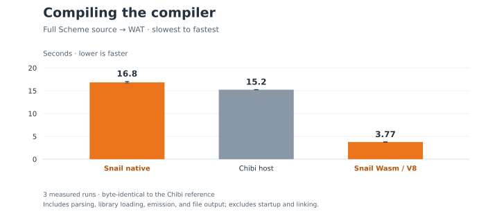

# Native and V8 baseline before the Wasm-only migration

The complete 57-workload matrix attempted every requested Native, V8, and Chez
case. Native passed 48, V8 passed 47, and Chez passed all 57. Among the **47 common
successes**, V8 was faster on 37; the geometric mean of Native/V8 median-time
ratios is **1.9958**. This is a conditional comparison, not a full-suite score.

The separate compiler workload took **3.769 s on V8** versus **16.829 s on
Native/BDWGC**: V8 was **4.46× faster**. Chibi took 15.224 s. Every compiler run
produced the same reference WAT bytes.

These measurements support using the existing engine for Scheme execution. They
do not attribute the whole difference to GC or explicit roots: allocation,
code generation, runtime calls, IO, and engine policies all contribute. Native
wins on ten common successes, including `paraffins`, `string`, `fib`, and `tak`.
The largest V8 advantages here include `graphs` (9.30×), `earley` (7.88×), and
`deriv` (4.82×). Consult the individual charts before generalizing.

## Workload and timing boundaries

- Source baseline: `5c277ab69f5625a2d3c52c2d0c865d2b8332e66d`, preserved on
  [`archive/llvm-backend-20261012`](https://github.com/tsnl/snail-scheme/tree/archive/llvm-backend-20261012).
- Measurement harness: `bd209b1` on
  [`experiment/r7rs-native-v8-20261012`](https://github.com/tsnl/snail-scheme/tree/experiment/r7rs-native-v8-20261012).
- Corpus: all 57 workloads at upstream
  `85f6acdc4cc4e2b857f307ba56bd0ba931dcccd1`. Original inputs and iteration counts
  are retained in [inputs/](inputs/); no smoke scaling.
- Every build completed before timing. Native and V8 use identical optimized
  Scheme-only module bytes for each of the 56 buildable pairs. Their hashes are
  recorded in `paired_scheme_modules` in [results.json](results.json).
- Each successful case received one discarded preliminary process, followed by
  three fresh measured processes in rotating order. CPU affinity was logical
  CPU 5 on an Intel Core Ultra 7 270K Plus. Migration builds/tests did not overlap
  these primary timings. `BINARYEN_CORES=1` controlled preparation.
- Suite durations come from the upstream Scheme timer; process startup and
  compilation are excluded. Wall times and complete stdout/stderr are also
  retained. Correctness predicates ran each time; `ray` additionally checked the
  complete pixel checksum.
- Native used the production BDWGC path with default heap policy, Clang/LLD
  21.1.8, and BDWGC 8.2.12. No experimental root or collector prototype is used.
  Node 24.19.0 uses V8 13.6.233.17-node.51; Binaryen is 132; Chez is 10.4.1.
  JSON records tool paths, versions, hashes, environment, and commands.

The earlier five-system run was interrupted during preliminary measurements to
focus the overnight work on Native/V8 with Chez as the reference. Its
[incomplete raw report](interrupted-five-system-results.json) is preserved. The
three-system report starts fresh preliminary and retained rounds; it does not
reuse selectively chosen samples from that interrupted run. There are no Guile
or Chibi suite medians claimed here.

## Results and limitations

| System | Passed | Runtime error | Build error | Timeout |
| --- | ---: | ---: | ---: | ---: |
| Native/BDWGC | 48 | 7 | 1 | 1 |
| Wasm/V8 | 47 | 8 | 1 | 1 |
| Chez | 57 | 0 | 0 | 0 |

The [complete matrix](summary.md) links all 57 charts; [CSV](summary.csv) and
[raw JSON](results.json) preserve every cell.

`puzzle`, `ctak`, `fibc`, and `maze` encounter unsupported `call/cc`. Native
`quicksort` also reaches that diagnostic; V8 `quicksort` first exhausts its call
stack. V8 `ack` exhausts its stack, while Native succeeds. `pi` and `chudnovsky`
fail at exact-integer reading; `compiler` fails during compilation on an exact
literal exceeding signed i64. `equal` times out after 300 seconds on both Snail
paths. Failures block subsequent measured attempts for that cell and remain
visible rather than contributing fake durations.

The workload named `compiler` in this suite is distinct from the Snail compiler
baseline below. None of these data establishes full R7RS conformance.

## Compile the Snail compiler

| Host | Median seconds | Retained runs |
| --- | ---: | ---: |
| V8 | 3.769182431 | 3 |
| Chibi | 15.224 | 3 |
| Native/BDWGC | 16.829067907 | 3 |

[Compiler raw data](compiler-results.json) includes discarded preliminaries,
all measured samples, build commands, output validation, and source hashes.
Native and V8 consume the same optimized compiler module:
`1094e82d2e981f95a965719cbf120c52e43a798e1f13a32bea0db7a1a457615b`.
Their emitted WAT matches the Chibi reference:
`8f642303588a0df7bb7da2bd6e4a7b2ed89d40ca5b3b0df23ff00484d86af85c`.

The timed operation reads frozen compiler Scheme sources and emits WAT. Building
and linking the compiler executable happens before measurement. This remains a
compiler-host comparison; it does not change the project's Chibi bootstrap policy.

## Reproduction and retained evidence

Use the experiment branch for the original Native/V8 build path. Its harness
supports `--prepare-only`, a frozen report consumed by `--measure`, and `--plot`
for regenerating charts. Select `--systems snail-native snail-wasm chez`, keep
original inputs, use `--rounds 3 --cpu 5`, and retain all failures. Exact commands
and paths for every cell are in the JSON. On another machine, choose an available
CPU and record the changed tools and environment rather than claiming identical
conditions.

[frozen-inputs.tar.xz](frozen-inputs.tar.xz) contains deduplicated captured Wasm,
WAT, LLVM, and runtime inputs, the compiler source snapshot, reference output,
and frozen Node host. Original case paths in JSON describe the measurement
workspace; rebuild them with the archived harness. The capture directory uses
content hashes. [measurement-environment.json](measurement-environment.json)
records the capture wrappers and real tool paths.

These are **pre-migration** performance results. The Wasm-only migration changes
module organization and host behavior; its validation smoke runs are not used
as new performance claims. Current `benchmarks/r7rs.py` defaults to Wasm/V8,
Chez, Guile, and Chibi; the historical native implementation stays on its archive.
