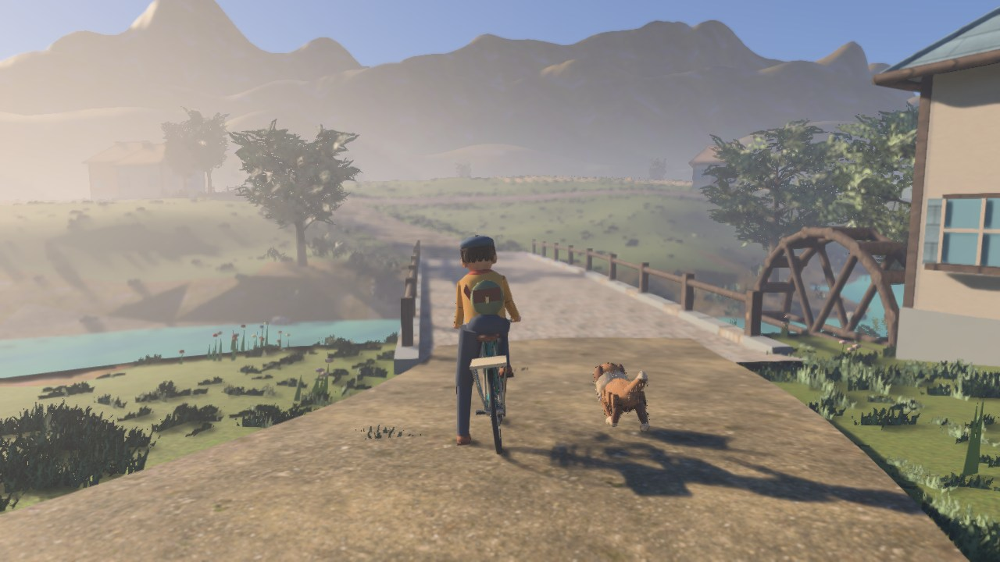

# If You’re Going That Way

From the shop awnings on Lantern Row you can follow the paved lane north, cross Mill Bridge and climb to Foxglove Farm. The first dirt turning on the left climbs through the orchard. The right-hand turn leads past Reedwater, where a footbridge takes you around the millpond. Moss follows the courier by bicycle and on foot. Each visit starts a fresh ride. Open the pause menu and choose **Save game** to keep your position, parked bicycle, distance and settings in this browser. **Load game** resumes the last saved ride, including saves from earlier versions. [Ride through Willowbank](../play/iygtw/).



| Action | Control |
| --- | --- |
| Get off or mount a nearby bicycle | F or the bicycle button |
| Walk relative to the camera | W, A, S, D or the arrow keys |
| Run | Hold Shift while walking |
| Pedal and steer | W, A, D or the arrow keys |
| Coast | Release the pedals |
| Brake and hold on a hill | Space |
| Stop, then walk the bicycle backwards | Hold S or Down |
| Get back on after a fall | E, once the rider settles |
| Ring the bell | B |
| Orbit the rider and zoom | Click the view, move the mouse, scroll |
| Centre the camera | C |
| Set the time of day | L or the light button |
| Open or close the pause menu | P, Esc, or the pause button |
| Return to Lantern Row with Moss | R or **Reset to Lantern Row** in the pause menu |

Willowbank’s rideable survey spans 176 × 176 metres. The roadster has a 1.08 m wheelbase. Holding a steering key gradually turns the bars. At higher speeds the same input makes a wider turn, and the rider banks into it. Each metre travelled under power advances the crank and both feet together. At a start or on a climb, the rider rises, shifts weight forward and puts more force into the downstroke. The rider settles back when coasting and puts a foot down at a stop. The camera follows independently of the lean. The game draws on each browser animation frame and interpolates between 20 ms physics steps. The display refresh rate determines how often you see the ride.

Press F while moving and the courier brakes before stepping off on the open side of the saddle. Walk away and the bicycle stays put. Turn the camera to choose a new direction, hold Shift to run, and approach the bicycle to ride again. The controller in `(snail shell game locomotion)` sweeps the walker against the village obstacles and advances the stride by the distance actually covered.

The shallow puddles on Lantern Row are visible from the shop. Take the first dirt turn to the left and ride a figure eight to see the two tyre paths diverge. On soft ground each pass presses a groove, up to 3.5 cm deep. The wheels settle into existing grooves. Turning through a pool pushes water aside and sends a ripple out from the tyre. Runoff seeps back over seconds, and undisturbed tracks soften over roughly three minutes of riding time. Pause freezes that clock. A saved ride includes the marked ground. Returning to Lantern Row also keeps the current tracks.

A glancing collision can turn the front wheel along a fence. A sharper stop throws the rider forward against the bars. A hard, square hit separates the rider from the bicycle. The torso tumbles under gravity, the limbs draw in, and the bicycle tips onto its side. Once the rider settles, E gets them back on beside the obstacle. Hold S or Down to walk clear, including uphill.

The game renders at the canvas’s physical pixel dimensions. The pause menu sets 1× or 4× MSAA. L cycles through morning, midday, sunset and moonlight. The visible sky and its filtered environment provide reflections and indirect light, while the sun or moon casts cascaded shadows. Skinning moves the hands, grip targets and pedals together, including when walking the bike backwards.

To measure Lantern Row, the mill bridge and the orchard, serve a build locally and run the following command. Omit `--profile` to measure frame intervals without GPU timestamp instrumentation. Add `--memory` to sample Chrome’s node and listener counters and collect garbage outside the timed ride. Use `--no-vsync` to measure how fast headless Chromium can submit frames with its display limiter disabled.

```sh
node benches/iygtw/ride.mjs http://127.0.0.1:4193/ 1920x1080 1 --profile
```

At native 1920×1080 and 1× MSAA on an RTX 5090, the earlier 30 fps limiter submitted every second refresh of Chromium’s 60 Hz display. The three routes now average 60 fps. The profile reports time in the application, time waiting on the GPU queue, and GPU pass timestamps. GPU execution can overlap both the application and the interval before the next refresh.

The village, road surfaces, courier, bicycle and dog load before the first ride. The renderer uploads their model once. Crossing from Lantern Row to Field Road or from Mill Bridge to Foxglove Farm changes the HUD and keeps the same GPU buffers. The benchmark counts mesh uploads and measures the frame interval when the place name changes.

## Editing Willowbank

Open `src/apps/iygtw/art/Willowbank.blend` in Blender to edit the level. The collections group the village, water, roads, farms and distant hills. The road meshes supply the visible surface and wheel contact. Their survey curves record the alignments. Edit the mesh when changing the riding surface. A mesh tagged `iy_surface` supplies the surface type and wheel height. The exporter projects the `iy_solid` and `iy_fence` meshes into obstacle spans. The `iy_waymark` empties name places, and marker zero sets the starting position.

`Roadster.blend` contains the weighted bicycle and courier. The seated and standing pedal actions share a crank phase. Two steering actions keep the hands on the grips in either posture. The rig includes bracing, tumbling and walking the bicycle backwards. On foot, the idle, walk, run and two saddle-crossing poses animate the courier independently of the parked bicycle. With the file open in Blender, `src/blender/bake_roadster.py` rebuilds these actions from the rest rig.

The courier's head, eyes and continuous forearm and hand meshes use Blender Studio’s CC0 Human Base Meshes. The jacket, cap, hair and post bag are authored for Willowbank. To rebuild the character mesh in Blender, run `src/blender/dress_courier.py` with the roadster file open and the extracted human base mesh file after `--`. The arm fit uses the shared wrist loop of the sculpt and three articulated joints per digit. The seated and standing actions orient the knuckles along the swept grips. Run the action bake after redressing the character. The finished roadster packs all its textures. The source material retains the scattering weight authored in Blender.

The editable hollows in the level’s **Road drainage** collection set the pool centres and radii. In the level file, `src/blender/plant_verges.py` replants the sedges, dock, foxgloves, hazel and ash canopy along the lanes. `Moss.blend` contains the dog's rig and trot. Run `src/blender/groom_moss.py` with the dog open to comb its coat. The dog and courier keep an opaque undercoat or hairline under skinned, alpha-tested ribbons. Each ribbon carries a painted comb of individual fibers. Both actors use the shared skinning pass.

After an art edit, run `make iygtw-art` with Blender on the path. Check in the source and its exports together. A normal `make iygtw` uses the checked-in exports. The browser downloads the nine files in `main.resources` with progress, caches them locally and reuses them on subsequent visits. Tree sprays, grass blades, gravel, plaster, timber and other material scans are credited in the game. [Willowbank art credits](../play/iygtw/CREDITS.txt).
