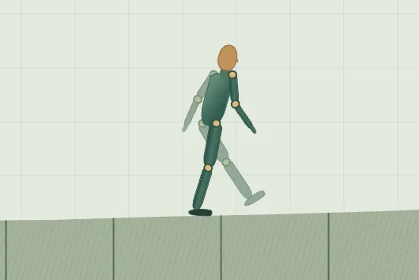

# If You’re Going That Way

Choose a target speed and watch the walker cross a section of Willowbank. The hips, knees and ankles follow a captured stride through powered joints. The two colours distinguish the near and far limbs. Change pace during a trial, switch courses, or restart after a fall. [Open the walking study](../play/iygtw/).



## The first controller

The simulation uses the same Rapier runtime as the game's vehicles. The trunk and two three-link legs have mass and inertia. Six torque-limited hinge motors act between bodies. Foot contact, friction and gravity determine how far the walker travels. The pelvis can pitch, rise and fall freely in a vertical plane. The arms follow the capture for display. Each trial begins mid-stride with the velocities estimated from the capture.

The policy runs at 30 Hz and Rapier takes four steps between decisions. The requested forward speed sets the reference cadence. Both legs share 15 feedback gains. The policy observes pitch, pitch rate, speed error, foot placement and terrain height. The lower ankle relative to its local surface gets more of the balance correction. Motor targets can depart from the reference to keep the walker upright.

The training courses are Lantern Row, Orchard Rise and Lower Fields. Each course samples a straight section of Willowbank’s checked-in collision survey at half-metre intervals. The resulting strip supplies the triangles the feet actually contact. This first study covers forward walking on height profiles. Lateral balance, turning and the village’s obstacle geometry are outside the trial.

## Train and replay

From the repository root in the pinned shell, run the following commands. The trainer uses the CPU implementation of the Snail tensor library. The output file contains the learned gains as little-endian floats.

```sh
./snail-scheme run --target node benches/iygtw/train-walk.scm train 224 3271 build/walk.bin
./snail-scheme run --target node benches/iygtw/train-walk.scm eval build/walk.bin
./snail-scheme run --target node benches/iygtw/train-walk.scm baseline
```

The evolution strategy samples 32 children from six surviving policies. A tensor graph gathers parent rows and applies Gaussian perturbations to their gains. Every candidate in a generation receives the same trials. Speed agreement and joint-angle agreement earn reward, and a fall ends the return. Ranking combines the mean and the worst course. Training starts on level ground and introduces the measured grades in two stages. It keeps only the population and scalar returns.

Evaluation runs for eight seconds per course with a speed change at four seconds. The report includes distance, mean speed during each half, speed error, joint tracking error and upright ticks. A fall contributes zero further distance and the remaining requested speed counts as error. Joint RMS is measured while the trial is live. Two more trials use the same level surface and initial pose at different constant commands.

The shipped checkpoint stayed upright for all eight seconds on Mill Bridge (4.62 m), Foxglove Farm (5.39 m) and High Meadow (9.17 m). The initial gains fell within 0.9 seconds on each. On level ground the trained walker averaged 0.87 m/s at a 0.8 m/s command and 0.92 m/s at a 1.2 m/s command. It changes pace, but it undershoots the faster command.

To open the trained walker locally, run `make iygtw` and serve `build/src/apps/iygtw/main/`. The earlier cycling prototype has its own entry and art guide. [Willowbank prototype](willowbank.md).

## Motion and skeleton

The reference is one 1.27-second stride from DeepMimic's generic humanoid. Its 15-joint skeleton specifies parentage, segment lengths, masses and joint limits. The game projects the leg and arm rotations into the walking plane and retains the pelvis height and pitch. The 38 poses and their timing and stride length occupy 924 bytes. The source clip repeats its first pose one stride ahead at its last timestamp. The packed loop interpolates across this seam. [Humanoid skeleton](https://github.com/xbpeng/DeepMimic/blob/1f915c52fcd4b95b5f5f15b759ae91bd81e9a801/data/characters/humanoid3d.txt) · [Walking capture](https://github.com/xbpeng/DeepMimic/blob/1f915c52fcd4b95b5f5f15b759ae91bd81e9a801/data/motions/humanoid3d_walk.txt) · [License and credits](../play/iygtw/CREDITS.txt).

To reproduce the packed reference, download the single 36,185-byte clip at the linked revision. The packer verifies its SHA-256 before projecting it.

```sh
python3 benches/iygtw/pack-walk.py humanoid3d_walk.txt build/stride.bin
cmp build/stride.bin src/apps/iygtw/walking/stride.bin
```

Bandai Namco’s BVH collection also has small, individually downloadable walking takes. Dataset 1 includes a neutral walk (238 KiB), an active walk (179 KiB) and a tired walk (300 KiB). Bandai Namco distributes these under CC BY-NC 4.0. Adobe's Mixamo terms prohibit using its assets to train or test machine-learning models. The shipped walker uses the DeepMimic reference. [Neutral](https://github.com/BandaiNamcoResearchInc/Bandai-Namco-Research-Motiondataset/blob/74ead3ba1ae4696404e6086233779f60de8bf9ef/dataset/Bandai-Namco-Research-Motiondataset-1/data/dataset-1_walk_normal_001.bvh) · [Active](https://github.com/BandaiNamcoResearchInc/Bandai-Namco-Research-Motiondataset/blob/74ead3ba1ae4696404e6086233779f60de8bf9ef/dataset/Bandai-Namco-Research-Motiondataset-1/data/dataset-1_walk_active_001.bvh) · [Tired](https://github.com/BandaiNamcoResearchInc/Bandai-Namco-Research-Motiondataset/blob/74ead3ba1ae4696404e6086233779f60de8bf9ef/dataset/Bandai-Namco-Research-Motiondataset-1/data/dataset-1_walk_tired_001.bvh) · [Bandai Namco license](https://github.com/BandaiNamcoResearchInc/Bandai-Namco-Research-Motiondataset#license) · [Mixamo terms](https://wwwimages2.adobe.com/content/dam/cc/en/legal/servicetou/Mixamo-Addl-Terms-en_US-20210623.pdf).

## Synthetic walking references

Kimodo can generate walking references offline. Its human SOMA model accepts text and timed ground-plane waypoints. Specifying 4.8 metres of travel over six seconds gives the generator a target of 0.8 m/s. Label each resulting stride by its measured speed. NVIDIA lists synthetic data and game animation as intended uses of Kimodo-SOMA-RP-v1.2. Its Open Model License permits commercial use and NVIDIA claims no ownership of generated outputs. [Model card](https://huggingface.co/nvidia/Kimodo-SOMA-RP-v1.2) · [License](https://www.nvidia.com/en-us/agreements/enterprise-software/nvidia-open-model-license/).

To try it with little disk, download `motion.npz` from one of NVIDIA’s published examples. Cycle 0 of the slow path walk gives a 900-byte stride at 1.03 m/s on our rig. The casual walk gives an 828-byte stride at 1.44 m/s. The converter requires NumPy. Rapier and the Snail trainer consume only the packed file. [Slow path walk](https://github.com/nv-tlabs/kimodo/tree/e1c219c99b4b94ba48be1fb6a1cbc64ecee4c954/kimodo/assets/demo/examples/kimodo-soma-rp/05_root_path) · [Casual walk](https://github.com/nv-tlabs/kimodo/tree/e1c219c99b4b94ba48be1fb6a1cbc64ecee4c954/kimodo/assets/demo/examples/kimodo-soma-rp/02_multi_text_prompt).

```sh
python3 benches/iygtw/pack-walk.py kimodo motion.npz 0 build/synthetic-stride.bin
./snail-scheme run --target node benches/iygtw/train-walk.scm \
  --reference build/synthetic-stride.bin train 224 3271 build/synthetic-policy.bin
./snail-scheme run --target node benches/iygtw/train-walk.scm \
  --reference build/synthetic-stride.bin eval build/synthetic-policy.bin
```

Each cycle starts and ends on a right heel strike. The packer uses the SOMA joint positions and rotations to measure leg, trunk and arm angles, then scales lengths to the game's legs. It reports how closely the end pose matches the start and how fast a labelled planted toe moves. Turning strides and large discontinuities are rejected. Ground contact and the rewards during training come from the simulation.

With 224 generations and seed 3271 for each reference, the casual-walk policy crossed 8.42 m on High Meadow and fell on the other two held-out courses. The slow-walk policy fell on all three. The captured-stride policy completed all three. These trials establish that the trainer can use generated motion. Whether adding synthetic strides improves the mocap-trained walker is still open.

To make a new clip on a machine with Kimodo installed, run the command below and pass `walk.npz` to the same packer. Add `--constraints PATH` for timed waypoints. The v1.2 motion weights alone occupy 1.13 GB, in addition to the text encoder. [Generation CLI](https://research.nvidia.com/labs/sil/projects/kimodo/docs/user_guide/cli.html) · [Model files](https://huggingface.co/nvidia/Kimodo-SOMA-RP-v1.2/tree/main).

```sh
kimodo_gen "A person walks steadily forward." --model Kimodo-SOMA-RP-v1.2 \
  --duration 6 --num_samples 1 --seed 42 --output walk
```
