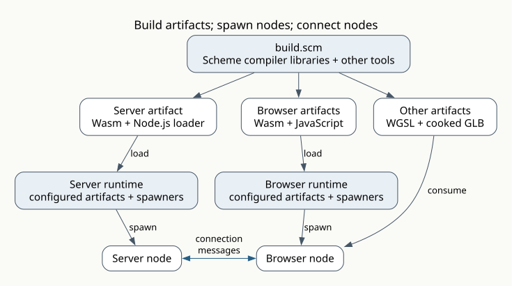
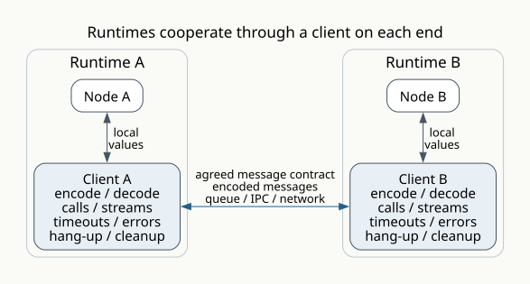

# Nodes and Runtimes

This chapter explains what we mean by **node**, **artifact**, **spawn**,
**connect**, **message**, and **runtimes**. Along the way, we explain spawners,
connections, the client at each end, and workflows/sessions that put them together.

The installed [command runtime](platforms/native-cli.md) runs one Wasm node.
Node connections and browser GUI platforms are not implemented yet.

The examples use Scheme-like pseudocode to explain the model. The
[runtime pages](platforms/index.md) document available implementations and their
executable interfaces.

## The model

`build.scm` produces **artifacts**: code or data. A **node** is one running
instance with its own state. A node need not occupy a whole machine.
**Runtimes** run nodes using a selected **platform**: a collection of effect handlers
with specific IO and host semantics. See [effect interfaces](effects.md).

A node uses its runtime's **spawner** to create another node:

| Operation | Input | Result |
| --- | --- | --- |
| **Spawn** | Artifact and initial data | A new node's running identity, once ready |
| **Connect** | An existing node's running identity | A connection to that node |

The node requesting spawn owns the new node's lifetime; runtime bootstrap
owns the initial node. One **connection** has a **client** at each end. Connect
creates both clients and keeps the existing node.

Nodes exchange **messages**, optionally expecting replies. Runtimes cooperate
to make connections work across their nodes: they agree on the message contract,
route messages, and handle serialization and communication. A browser node and
a server node use the same connection operations even though their runtimes
perform different IO. Their clients match replies, report errors/timeouts, and hang up.
Hanging up ends that connection; stopping ends a node. A failed call may already
have taken effect.

Runtimes choose how spawn works: a process, a browser worker, or browser artifacts
loaded by navigation and reporting readiness. **Workflows/sessions** are ordinary
code deciding when to spawn, connect, and stop.



The same Scheme library can appear in several artifacts. Its nodes still have
separate state. A game build can also cook GLB files and compile a shader DSL to
WGSL, embedded in Wasm or supplied separately. These are artifacts consumed by
nodes. Script arguments can also select linting, tests, or packaging the output
for release. Each tool used by the script comes from the project's chosen libraries
or external programs.

## An example: one counter, two browsers

The server node holds the count. Each browser node has its own view of that
count, an increment button, and a refresh button. The runtime runs the counter's
short message handlers one at a time. Both browsers talk to the same running
server node.

An ordinary `build.scm` produces the files. The build operations below exist;
the browser loader and connection platform in this example remain model components:

The script imports the build libraries and wraps these calls in a trace scope.

```scheme
;; build.scm
(build-wasm "." "counter-server.scm" "out/counter-server.wasm")
(build-wasm "." "counter-browser.scm" "out/counter.wasm")
(copy-file "browser-loader.js" "out/counter.js")
```

The server runtime is configured with these artifacts and appropriate spawners:

| Artifact name | Files | Spawner |
| --- | --- | --- |
| `counter-server` | `out/counter-server.wasm`, Node loader | `nodejs-spawner` |
| `counter-browser` | `out/counter.wasm`, `out/counter.js` | `browser-spawner` |

Its bootstrap starts the initial server node:

```scheme
(spawn nodejs-spawner 'counter-server '())
```

The server node exports two message handlers. Once ready, it asks its runtime
to spawn two browser nodes, passing **its running identity** to both. The
server node owns their lifetimes; the browser spawner performs the startup.

```scheme
;; counter-server.scm
(define count 0)

(define (increment)
  (set! count (+ count 1))
  count)

(define (refresh) count)
(export-messages 'counter increment refresh)

(define (open-browser)
  (spawn browser-spawner 'counter-browser
         (options (initial-data `((server . ,(current-node))))
                  (on-progress show-start-url))))

(on-ready (lambda () (open-browser) (open-browser)))
```

Each browser spawn prepares a separate navigation URL for the configured
JavaScript and Wasm. The application's `show-start-url` callback presents these
URLs; each spawn completes when that browser has loaded and
reported readiness. Waiting for browser startup must leave the server able to
handle messages. The [browser startup contract](runtime-contracts.md#a-server-runtime-spawning-a-browser-node)
spells out navigation, timeout, and cleanup.

The browser artifact selects `browser-start` as its startup handler. It connects
once. `await` below means asynchronous waiting;
`on-result` registers success and error callbacks. Waiting leaves the runtime
free to handle other messages and browser events.

```scheme
;; counter-browser.scm
(define (browser-start data)
  (let ((connection (await (connect (data-ref data 'server) 'counter '()))))
    (define (request name)
      (on-result (call connection name '() 5) show-count show-error))
    (on-click "increment" (lambda () (request 'increment)))
    (on-click "refresh" (lambda () (request 'refresh)))
    (on-leave (lambda () (hang-up connection 'page-left)))
    (request 'refresh)))
```

Here `5` is a timeout in seconds. UI procedures come from the browser runtime's
libraries. The clients own reply matching; application code needs no request IDs
or serialization code. Messages carry data; reply callbacks stay local. The UI
shows the most recently received count.

If browser A leaves, its connection closes and browser B keeps working. Browser
A's page may stop executing before it sends hang-up; the server client detects
that failure. When A returns, this example's workflow/session calls
`open-browser` again and supplies the same server identity to the new browser
node. Its first refresh reads the retained count.

If an increment's reply is lost, the browser reports an error and does not retry
automatically. Refresh reads the current total; if the connection has failed,
reopening the browser first establishes a new connection. With two browsers,
the total cannot establish whether a particular increment happened. Avoiding
duplicate effects on retry requires an explicit application rule.

## A connection has a client on each end



One `connect` establishes both clients. They are runtime state belonging to the
connection. The application does not spawn them or make a second connection for
the server side. Either node may send messages if their agreed contract allows
it. Hanging up closes this connection; other connections and both nodes can
continue. The [runtime contracts](runtime-contracts.md) describe client
state, pending work, failure handling, and specific spawning mechanisms.

Compatible runtimes hide their communication mechanisms behind that contract.
They still report unreachable nodes, incompatible messages, and lost connections
as errors. Making connections work across runtimes does not make remote work
infallible or erase the uncertainty of a lost reply.

## Check your understanding

1. A build produces one server artifact, and the runtime spawns it twice. How
   many nodes exist, and do they share the counter's mutable state?
2. Both browser nodes need the same counter. What should each receive in its
   initial data, and why should each connect rather than spawn another counter?
3. Who owns the two browser nodes' lifetimes? Does connecting to the server
   give either browser ownership of the server?
4. One browser calls `connect`. How many clients are created, and who creates them?
5. The two nodes use different runtimes. What must those runtimes do together
   so the application can use a connection without writing network or codec code?
6. A browser hangs up. What happens to the server, the other browser, and their
   connection? How is this different from stopping the server?
7. An increment times out after reaching the server. Why could retrying make the
   counter advance twice, and why does refreshing not settle what happened to that call?
8. A browser spawner has returned a navigation URL. What must happen before
   spawn can complete successfully?
