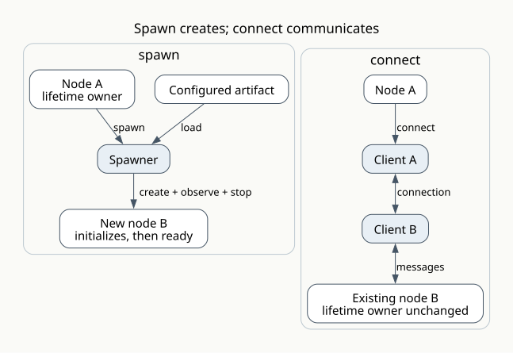
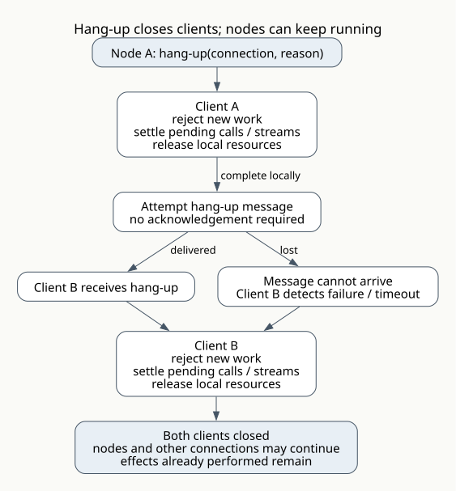
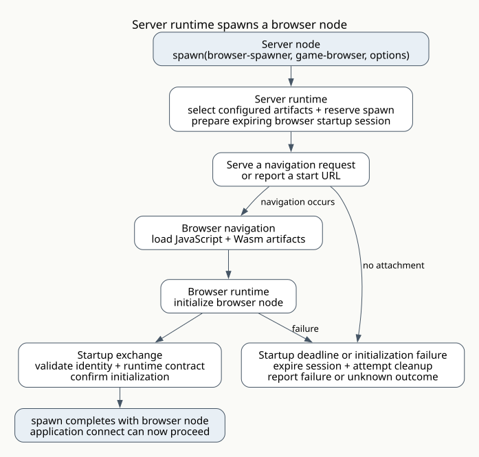

# Runtime contracts

Start with [nodes and runtimes](nodes.md). This chapter defines how runtimes
cooperate to implement the model: they establish connections, exchange messages,
and handle startup, errors, and shutdown. The signatures are model notation;
each [runtime page](platforms/index.md) lists its supported operations and concrete
interfaces. Futures and streams describe asynchronous results without choosing
Scheme syntax or a suspension implementation.

## Operations in the model

In these signatures, `node` identifies a running instance by runtime address
and instance identity. Restarting the same artifact creates a new identity.
The description grants only access recognized by the receiving runtime; it
contains no pointer into the node's heap.

```text
spawn(spawner, artifact, options)             -> future<node>
connect(node, message-contract, options)     -> future<connection>

message(connection, name, arguments)          -> accepted | error
call(connection, name, arguments, timeout)    -> future<value>
stream(connection, name, arguments, timeout)  -> stream<value>

hang-up(connection, reason)                   -> closed-locally
stop(spawner, node, reason, timeout)         -> future<stopped | unknown>
```

`message`, `call`, and `stream` use the same connection clients. A message
contract says which named messages are permitted in each direction, their
argument types, and whether they produce no result, one result, or a stream.
The runtime dispatches a named message to an ordinary exported handler. A
type-specific library can present those handlers as ordinary procedure calls.
The message contract supplies the type information needed to encode and decode
values. Both runtimes must understand that contract.

`message` returning `accepted` means the local client encoded the value and
accepted it into its bounded outgoing queue. It does not acknowledge remote
receipt or completion. A full queue produces a local error.

`call` completes with a decoded result or an error. `stream` delivers decoded
items and a terminal result or error; its contract must also specify bounded
buffering and what ends a stream that receives no further items. These operations
do not block the runtime's scheduling thread while waiting. Ordinary handlers
run to completion unless their runtime explicitly supports suspension. The
existing synchronous [ABI](abi.md#calls-stay-inside-a-node-connections-cross-nodes)
cannot suspend through arbitrary Rust/C calls.

The following options have concrete meanings:

| Operation | Options and guarantees |
| --- | --- |
| `spawn` | Initial message data; descriptions of nodes the new node may connect to; startup timeout; supported resource limits; an optional local procedure receiving progress messages such as a browser start URL. The requesting node owns the spawn unless the runtime explicitly transfers that ownership. |
| `connect` | Setup timeout, compatible message-contract revision, credentials supplied by the runtime, message/queue limits, and failure-detection policy. Both runtimes must accept the contract before setup succeeds. |
| `stop` | Available only to the lifetime owner or someone explicitly granted that right. `stopped` requires evidence of termination under the spawner's contract; inability to confirm termination produces `unknown`. |

The requesting node owns the new node's lifetime; the spawner performs startup
and observes it. Runtime bootstrap owns the initial node. The progress
procedure stays local. Initial data may identify nodes to connect to, but live
connections and their pending calls stay with the node that opened them.

## Spawning and connecting



A successful `spawn` means that the selected artifact was loaded, initialization
completed, and the runtime can accept messages for the new node. It does not
return an application connection. The caller can then `connect`; another node
can connect to that same node independently. Runtimes may use internal startup
messages while spawning without making those an application connection.

A successful `connect` means both clients accepted the other node's identity,
the message contract, and the limits. The receiving runtime allocates its client
for an existing node and exposes the accepted connection to that node through
its ordinary message handling. This never silently spawns a replacement node.

Each node can therefore have a different lifetime owner and set of connections.
Hanging up all its connections need not stop it. Stopping a node closes all its
local clients; the clients on the other ends detect that through the available
mechanism. Choosing to stop a node after its last connection closes is a
workflow/session rule.

The requesting runtime assigns a spawn identity before sending the request;
the spawner tracks it before starting work and pins the chosen artifact version.
If startup fails after creation, it attempts cleanup and
reports whether termination was confirmed. Losing contact with a remote spawner
can leave the outcome unknown. Query or cancel the same spawn identity where the
spawner supports it; silently repeating `spawn` could create another node.
Durable recovery after a runtime crash requires an additional runtime contract.

## A connection has a client on each end


The word **client** applies to both ends, including the end in a server runtime.
It describes the local implementation of a connection. It is not an additional
node. Either node can initiate messages if the agreed contract permits them.

Each client validates and encodes outgoing values, decodes incoming values,
matches replies to pending calls, and reports errors to its node. It enforces
queue limits and timeouts and releases connection resources on hang-up. It
records both nodes' identities without acquiring ownership of their lifetimes.

Runtimes cooperate during `connect`: identify the existing node, check access
and message compatibility, choose a shared communication mechanism, and create
the two clients. Each runtime translates between its own local values and their
agreed message representation. The application uses the same connection
operations across runtimes; it does not assemble a network client and server
for every pair of nodes. Unsupported combinations fail during connection setup.

The client state can be represented as:

```text
client = {
  connection-id, local-node, other-node, message-contract, state,
  next-request-id, outgoing, incoming,
  queue-limits, timeouts, message-transfer
}
```

The state moves from `opening` to `open` to `closed`; setup failure moves
directly from `opening` to `closed`. `closed` is terminal. The first terminal
cause is retained, every locally pending result settles once, and repeated error
or hang-up notifications cannot reopen the client or settle a result twice.
The runtime applies each client state change atomically. A call is encoded and
validated before its pending entry and queued message are installed together,
so a fast reply cannot arrive before the client can match it.

`outgoing` contains pending calls/streams and encoded messages awaiting transfer.
`incoming` identifies active requests from the other client. Both remain local.
The runtime must keep Scheme values rooted while retained, stop admitting work
before releasing roots, and never reuse roots from a failed node instance.

The transfer mechanism can be a queue, process IPC, a browser `MessagePort`, or
a network connection. Even a queue between nodes in the same process carries
encoded data. Decoding creates values owned by the receiving node. An encoded
buffer can be transferred; Scheme pointers, mutable object identity, closures,
and ABI roots cannot cross the connection.

These S-expressions illustrate the bookkeeping carried by messages. The runtimes
agree on an encoding; application code supplies only the message name and values:

```scheme
(call (connection "c17") (request 42)
      (message get-score "player-7"))
(result (connection "c17") (request 42) (value 900))
(error (connection "c17") (request 42)
       (code player-missing))
(hang-up (connection "c17") (reason session-ended))
```

Request IDs are local to each client's outgoing calls. A received call uses the
incoming table; a received result or request error uses the outgoing table. Both
clients can therefore issue request 42 without confusion. Connection routing
and message kind supply the direction. A stream also identifies items and
termination. Clients reject invalid kinds, types, sizes, and state transitions;
they never evaluate incoming expressions. Parsing needs allocation/depth limits
before validation can finish.

Several logical connections may share one socket. Hanging up one closes only
that connection's two clients. A socket failure affects every client using it.
Reconnecting creates a new connection identity; old results cannot accidentally
complete its calls. Resuming a previous stream needs an explicit message contract.

## Errors and hanging up



`hang-up` is idempotent. First mark the client closed, detach its pending calls,
and discard unsent messages. Then settle those calls/streams, attempt a bounded
hang-up message, and release connection resources. Completion callbacks may
reenter the runtime; they must see the already closed, empty client.
Hang-up finishes locally without waiting for acknowledgement. The runtime may
finish transferring the close message using owned bytes after the client's
Scheme roots have been released.

An already dispatched handler retains its own execution roots until it returns
or its node is stopped. Hanging up abandons delivery of its result; it cannot
free memory still in use by that handler.

The other client does the same cleanup when it receives hang-up. If that message
cannot arrive, its own failure detection and timeouts must make progress. One
client cannot guarantee immediate knowledge at the other end. Late replies are
discarded. Work already dispatched may have effects; connection closure neither
rolls them back nor proves that cancellation succeeded.

| Event | Responsibility of the clients |
| --- | --- |
| Encoding fails or the local queue is full | Report that this message was not sent. Keep the connection usable if its state remains valid. |
| A handler returns a declared error | Send an error for that request. Settle the corresponding call; keep the connection open. This requires recoverable handler errors in the runtime. |
| A call times out | Remove it from the pending calls. Report `not-sent` only if its queued message was removed before transfer took it; otherwise report `unknown`. Queue removal and transfer must be ordered. Cancellation can request cooperation but cannot undo effects. |
| A message violates the contract | Hang up the affected connection if the runtime can safely contain the failure. A fatal trap requires discarding the node instance and closing all its clients. |
| Either node hangs up | Its client closes immediately. The other client closes when notified or when failure is detected. Both nodes may continue through other connections. |
| A node dies | Its runtime closes every local client without calling back into the failed instance. Other clients settle pending work when they detect failure. |
| The network stops responding | Each client applies its local timeouts/failure policy. Silence cannot prove that the other node died. Outstanding outcomes may be unknown. |

Clients retain bounded late-result/cancellation bookkeeping and do not retry
application calls automatically. A workflow/session can use its own message IDs
and stored results when retry must avoid repeating effects. That guarantee is
stronger than identifying a request within one connection.

Each sending client preserves its accepted message
order on one connection. Calls can complete out of order. There is no total
ordering across directions or across different connections. Streams need an
explicit capacity/credit rule. For example, the browser WebSocket API does not
provide incoming backpressure, so the runtimes must bound and regulate their own
message flow. [WebSocket reference](https://developer.mozilla.org/en-US/docs/Web/API/WebSocket)

## Specific runtime spawning mechanisms

The interface remains `spawn`; the chosen spawner supplies the mechanism and
states its limitations. The following cases explain what each mechanism needs
to do. Availability belongs to the [runtime catalog](platforms/index.md).

| Runtimes and spawners | Concrete spawn mechanism | Readiness and stopping |
| --- | --- | --- |
| Server runtime, Wasm spawner | Start a subprocess containing the selected runtime, load the configured Wasm artifact, initialize its library, and establish IPC. A Node.js host can use `child_process.fork` for the process and IPC. | Ready after initialization and a startup reply. Observe process exit; stop by requesting shutdown and, if necessary, terminating and reaping the process. Owner-crash cleanup requires explicit OS/runtime support. |
| Server runtime, Node.js spawner | Start a Node.js process loading the configured Wasm artifact and platform imports. Supply initial data and runtime configuration separately from an application connection. | Process creation alone is insufficient: wait for the node startup reply. The spawner observes exit and reaps the process after stopping. |
| Browser runtime, worker spawner | Create a `Worker` from the configured JavaScript artifact, load its Wasm artifact, and use a `MessagePort` or worker messages for encoded data. | Ready after Wasm initialization. Termination can stop a looping worker. The worker has no DOM access, and forced termination does not run application cleanup. |
| Browser runtime, document spawner | Load the configured JavaScript and Wasm artifacts into an owned document or document subtree and register browser event handlers. A new browsing context may require user action. | Ready after initialization and connection setup requested by its startup data. Stopping can detach handlers and release owned resources; a looping main-thread handler cannot be preempted by another callback on that thread. |
| Server runtime, browser spawner | Select the configured browser artifacts, prepare a browser startup session, and serve an existing navigation request or report a URL for navigation. The browser runtime loads the artifacts and completes the startup exchange. | Ready only after the browser node attaches and initializes. Stop can revoke the session and request browser cleanup. Actual browser execution is `unknown` without acknowledgement or a mechanism that controls that browser process. |

The process mechanisms use the documented
[Node.js IPC operation](https://nodejs.org/api/child_process.html#child_processforkmodulepath-args-options)
and [Rust process operation](https://doc.rust-lang.org/std/process/struct.Command.html#method.spawn).
Browser worker creation, message passing, DOM restrictions, and immediate
termination are described in the
[Web Workers documentation](https://developer.mozilla.org/en-US/docs/Web/API/Web_Workers_API/Using_web_workers).

A runtime can expose its spawner through messages to another runtime. A remote
`spawn` then asks that runtime to perform one of these mechanisms. The runtime
that creates the node retains the actual process/worker observation and cleanup
responsibility. A shared address space is also possible, but requires per-node
state, roots, and resource ownership; the current Node.js command runtime does not yet
provide multiple instances in one process.

### A server runtime spawning a browser node



Here `spawn(browser-spawner, 'game-browser, options)` names an artifact configured
within the server runtime. Its configuration selects the exact JavaScript,
Wasm, and other files to serve. The browser receives a unique, expiring startup
description tied to that spawn and the selected artifact version. The server
validates the attachment and accepts one node instance for it.

An HTTP response carrying the loader must be sent before waiting for that loader
to report readiness. For an already pending navigation, the spawner can produce
the response. Otherwise, the local progress procedure receives a start URL that
the application can present. No navigation before the startup deadline means
startup fails and the session expires; a late attachment cannot revive it.

Serving files does not prove that a node started. The browser runtime must
report successful initialization. Conversely, a lost readiness reply can leave
an initialized browser node whose termination cannot be confirmed. The server
revokes its session and reports the uncertain outcome rather than claiming the
browser stopped.

This is how the server runtime handles spawning with artifacts configured within
it. It cannot promise to open an arbitrary user's browser window. Browser
`window.open` calls are constrained by user activation and popup policy.
[Window.open documentation](https://developer.mozilla.org/en-US/docs/Web/API/Window/open)
A server that controls a browser process can offer a separate spawner using
process launch and confirmed process termination.

Once ready, connecting to the browser node creates application connection
clients. A browser-initiated WebSocket can carry messages in both directions,
so network initiation does not decide who can call whom. The server must route
the connection to the particular browser instance and its accepted contract.
Reloading the page normally creates a new node; preserving a workflow/session
across reload requires explicit application state and a new connection.

## Interfaces for defining runtimes

A new runtime implements the same responsibilities with its own mechanisms:

```text
runtime:
  configured artifacts: name -> artifact files and runtime contract
  configured spawners:  name -> spawner
  connect:              identify an existing node and establish two clients
  clients:              encode, transfer, decode, dispatch, error, hang-up
  scheduling:           run handlers and make pending operations progress
  shutdown:             stop owned nodes as promised and close local clients

spawner:
  accepts:              artifact formats and required runtime operations
  start:                initialize a node and report progress/readiness
  observe:              report node completion, failure, or unknown status
  stop:                 request/force termination within declared limits
  owner-lost:           enact the declared workflow/session lifetime rule
```

A runtime contract lists the operations supplied by the runtime, the handlers
required from an artifact, accepted message types, relevant ABI/Wasm requirements,
and startup/stop guarantees. Unsupported requirements fail before application
initialization. For facilities that can fail only during startup, report that
failure and clean up the partial start under the spawner's stated guarantees.

A browser runtime need not supply server process creation. A server runtime
need not provide DOM operations. Runtimes can implement common contracts while
also exposing different spawners and messages. Files, GPU resources, and database
data can remain owned by a node or its runtime; messages carry descriptions
whose namespace, access, and lifetime both ends understand.

## Workflows/sessions

A workflow/session can be an ordinary Scheme library: spawn temporary frame
nodes, connect them to a long-lived game node, and hang up when a frame finishes.
The game node can own connections to browser nodes and retained resources.
Closing a browser connection can leave the game alive for reconnection. Ending
the game session can stop the nodes it owns and close its other connections.
Those are explicit rules of the game, expressed using the same interfaces.

The [model examples](tutorials/index.md) show how these rules apply to games,
chat, and training. A workflow/session chooses lifetime and retry rules using
the connection and spawning guarantees supplied by its runtimes.
